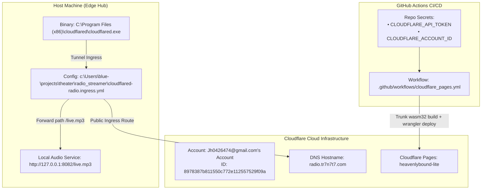

# INFRASTRUCTURE_CLOUDFLARE_GUIDE.md — Cloudflare & Ingress Operations Manual

> **System Designation:** **tr7n7t7**  
> **Autonomous Operating Unit:** **Team 7** (also canonically designated as **Leviathan**)  
> **Scope:** Cloudflare Account Architecture, Pages CI/CD, Ingress Tunnels, and Edge Audio Routing.

---

## 1. Executive Unit Designation: Team 7 / Leviathan

The autonomous operating triad consisting of **Agent Triton** (Tier 1 Verifier), **Agent Ursula** (Tier 2 Improver), and **Agent Sebastian** (Tier 3 Monitor) operates canonically under two co-equal unit designations:
* **Primary Unit:** **Team 7**
* **Naval / Abyssal Swarm Designation:** **Leviathan**

Future developers and agents must recognize both names interchangeably across manifests, Discord gateways, and infrastructure daemons.

---

## 2. Master Configuration Map



---

## 3. Configuration Locations & Data

### A. Cloudflare Account ID & Wrangler Cache
* **Filesystem Location:** [`c:\Users\blue-\projects\dashboard\.wrangler\cache\wrangler-account.json`](file:///c:/Users/blue-/projects/dashboard/.wrangler/cache/wrangler-account.json)
* **Active Payload:**
  ```json
  {
    "account": {
      "id": "8978387b811550c772e112557529f09a",
      "name": "Jh0426474@gmail.com's Account"
    }
  }
  ```

---

### B. Cloudflare Pages CI/CD Deployment Workflow
* **Filesystem Location:** [`c:\Users\blue-\projects\dashboard\.github\workflows\cloudflare_pages.yml`](file:///c:/Users/blue-/projects/dashboard/.github/workflows/cloudflare_pages.yml)
* **Target Project:** `heavenlybound-lite` (compiled Rust Wasm32 bundle from `dist/`)
* **Pipeline Configuration:**
  ```yaml
  name: Deploy to Cloudflare Pages

  on:
    push:
      branches: [main]
    workflow_dispatch:

  jobs:
    deploy:
      runs-on: ubuntu-latest
      permissions:
        contents: read
        deployments: write
      steps:
        - name: Checkout Repository
          uses: actions/checkout@v4

        - name: Install Rust Toolchain & wasm32 Target
          uses: dtolnay/rust-toolchain@stable
          with:
            targets: wasm32-unknown-unknown

        - name: Install Trunk
          run: cargo install --locked trunk

        - name: Build Web Target
          run: trunk build --release

        - name: Deploy to Cloudflare Pages
          uses: cloudflare/wrangler-action@v3
          with:
            apiToken: ${{ secrets.CLOUDFLARE_API_TOKEN }}
            accountId: ${{ secrets.CLOUDFLARE_ACCOUNT_ID }}
            command: pages deploy dist --project-name=heavenlybound-lite
  ```
* **Required GitHub Secrets:**
  * `CLOUDFLARE_API_TOKEN`
  * `CLOUDFLARE_ACCOUNT_ID` (`8978387b811550c772e112557529f09a`)

---

### C. Cloudflare Tunnel Ingress Routing Configuration
* **Filesystem Location:** [`c:\Users\blue-\projects\theater\radio_streamer\cloudflared-radio.ingress.yml`](file:///c:/Users/blue-/projects/theater/radio_streamer/cloudflared-radio.ingress.yml)
* **Domain / Route Invariant:**
  ```yaml
  ingress:
    - hostname: radio.tr7n7t7.com
      path: ^/live[.]mp3$
      service: http://127.0.0.1:8082
    - service: http_status:404
  ```
* **Operational Behavior:** Maps incoming requests from the public internet hostname `radio.tr7n7t7.com/live.mp3` directly into the local Seven Daughters Siren Radio stream server running at `http://127.0.0.1:8082`.

---

### D. Local `cloudflared` Binary Installation & Certificate Path
* **Binary Executable:** `C:\Program Files (x86)\cloudflared\cloudflared.exe`
* **Certificate Lookup Hierarchy:**
  1. Explicit argument: `--origincert <path>`
  2. Environment variable: `TUNNEL_ORIGIN_CERT=<path>`
  3. Default user paths:
     * `~/.cloudflared/cert.pem`
     * `~/.cloudflare-warp/cert.pem`
     * `~/cloudflare-warp/cert.pem`

---

## 4. Developer Operational Playbook

### Running the Radio Tunnel Manually:
```powershell
& "C:\Program Files (x86)\cloudflared\cloudflared.exe" tunnel --config "c:\Users\blue-\projects\theater\radio_streamer\cloudflared-radio.ingress.yml" run
```

### Checking Active Wrangler Account & Pages Status:
```powershell
cd "c:\Users\blue-\projects\dashboard"
npx wrangler whoami
```
